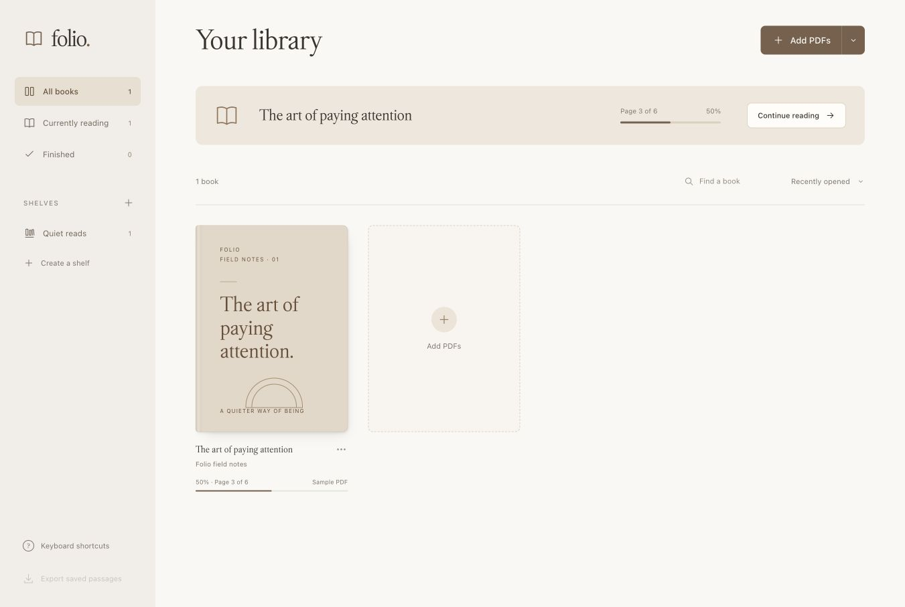
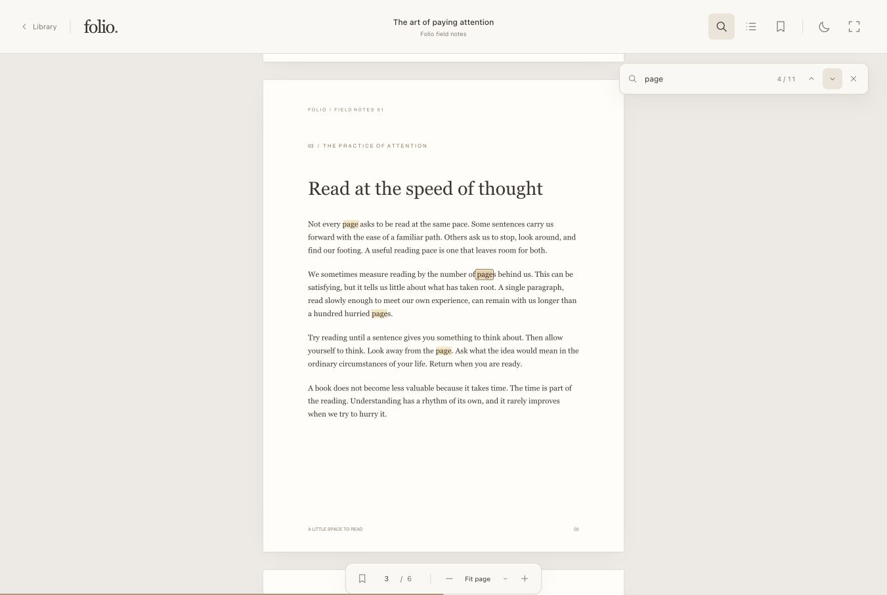

# Folio

A minimal PDF reader for Mac, with a personal library, quiet colors, and room to focus. Works entirely locally. A browser version is included too.



## Features

- **Your library.** Import PDFs, rename or delete custom shelves, and drag books between shelves or into your own order. Each shelf remembers its arrangement. Keep track of what you’re reading and where you left off.
- **Comfortable reading.** Continuous scrolling without visible scrollbars, trackpad pinch to zoom, fit controls, editable page numbers, and chapters when available.
- **Find a passage.** Search the whole PDF and jump between highlighted results.
- **Keep what matters.** Yellow, green, and pink highlights, page bookmarks, and notes. Export passages as Markdown, plain text, or JSON.
- **Less on screen.** Focus mode, light and dark reading backgrounds, and subtle transitions that respect reduced motion.

<details>
<summary>Reader preview</summary>



</details>

## Build the Mac app

Folio is distributed as source. Build it once on your Mac, then open it from Applications or your Dock.

Requires **macOS 13 Ventura or later**, **[Node.js 22.13 or newer](https://nodejs.org/en/download)**, and **Apple’s Command Line Tools**. Install the Command Line Tools if needed:

```sh
xcode-select --install
```

Clone and build:

```sh
git clone https://github.com/christianad11/folio.git
cd folio
npm ci
npm run build:mac
```

The build automatically matches your Mac:

| Your Mac | App location |
| --- | --- |
| Apple Silicon — M1 and later | `release/Folio-darwin-arm64/Folio.app` |
| Intel | `release/Folio-darwin-x64/Folio.app` |

Move **Folio.app** into **Applications**, open it, and drag its icon to your Dock. Node.js and Terminal are only needed for building; reading runs in the standalone app with no local server.

The build signs the app locally and also creates a ZIP in `release/`. Generated apps and archives are excluded from Git. Prebuilt app downloads are not published.

<details>
<summary>Build options</summary>

To build for another Mac architecture, set `FOLIO_ARCH`:

```sh
FOLIO_ARCH=arm64 npm run build:mac
FOLIO_ARCH=x64 npm run build:mac
```

Add `-- --dmg` to create a disk image too. The build uses a local ad-hoc signature. Distributing Apple-verified downloads would require a Developer ID certificate and notarization.

</details>

## Using Folio

Open PDFs with `⌘O`, drag them into your library, or choose **Open With → Folio** in Finder.

Select several PDFs with `⌘` or `Shift` in the file picker. They are added together, and the library stays visible so you can choose what to read. Skipping one file lets the remaining files continue.

Use a custom shelf’s **⋯** menu to rename or delete it. Deleting a shelf keeps its books. Drag book covers to arrange a shelf, or use **Move earlier** / **Move later** in a book’s menu. Choose **Shelf order** in the sorting control to return to your saved arrangement.

## Browser version

Requires **Python 3** and a current browser. No build step or package installation.

```sh
git clone https://github.com/christianad11/folio.git
cd folio
python3 server.py
```

Folio opens at [127.0.0.1:4337](http://127.0.0.1:4337/). Keep the terminal open while reading; press `Ctrl+C` to stop. On macOS, you can also double-click **Start Folio.command**.

Everything needed to read PDFs is bundled, so Folio works offline after cloning. The browser version uses a local server.

## Shortcuts

| Action | Shortcut |
| --- | --- |
| Search PDF | `⌘/Ctrl+F` |
| Next / previous search result | `Enter` / `Shift+Enter` |
| Focus mode | `F` |
| Chapters / saved passages | `C` / `S` |
| Bookmark page / save selected text | `B` / `H` |
| Zoom in / out | `+` / `−` |
| Close a panel or leave focus mode | `Esc` |

## Your data

The Mac app keeps its SQLite library and PDF copies in `~/Library/Application Support/Folio/`. Linked PDFs stay in their original locations. Use **File → Back Up Library** and **File → Restore Library** to move or back up PDFs, shelves, notes, highlights, and progress. Restoring merges with the existing library.

The browser version stores its library in IndexedDB. Use the same browser and address each time; clearing browser data removes that library. To move it into the Mac app, choose **Back up library** from the arrow beside **Add PDFs**, then restore the `.folio` file in the app.

Search and text highlights require selectable PDF text; OCR is not included. Exports contain your passages and page references, rather than an annotated PDF.

## PDF safety

PDFs are checked locally before import and reading, including linked files each time they open. Folio rejects detected document and page scripts, XFA forms, interactive media, and automatic open actions. A PDF with embedded files offers **Add anyway**; its attachments stay disabled. Your choice is remembered for that exact PDF, and a changed file requires confirmation again.

Documents run in an isolated renderer with PDF actions and external network access disabled. Files are limited to 256 MB and 10,000 pages. Large images are resized to a bounded canvas budget so covers and page content remain visible.

These checks reduce risk; they do not certify that a PDF is malware-free or replace antivirus software. Keep the bundled Electron and PDF.js versions current when rebuilding.

## Typography

The previews use [Michelangelus by Microsoft](https://www.microsoft.com/en-us/download/details.aspx?id=108856) for titles. The font is not included in the repository; builds use a system serif fallback by default. To use it locally, download it from Microsoft and place `Michelangelus-Regular.ttf` in `dist/assets/fonts/`. For a personal desktop build that includes your locally installed font, run `npm run build:mac -- --local-font`.

## Source

Plain HTML, CSS, and JavaScript in `dist/`. The desktop app uses Electron with an isolated renderer, native dialogs, and local SQLite storage; the optional browser version uses Python’s standard library. PDF rendering uses bundled **Mozilla PDF.js 6.4.299**. See [third-party notices](THIRD_PARTY_NOTICES.md) for its licenses. The included sample PDF contains original Folio field notes.

Run `npm test` to check persistence, shelf editing and ordering, backup and restore, PDF safety, and the local asset boundary.
